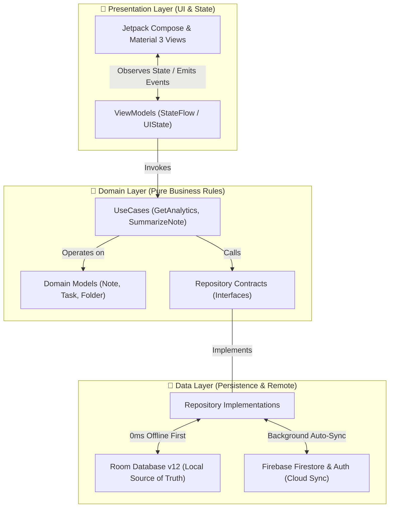
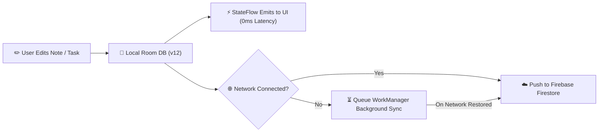

# 🚀 KNotes: AI-Powered Productivity Suite

<div align="center">

[](https://kotlinlang.org)
[](https://developer.android.com/jetpack/compose)
[]()
[]()
[](https://firebase.google.com)
[](https://www.android.com)

### ✨ Capture Ideas • Manage Tasks • Track Habits • Unleash AI Intelligence

</div>

---

## 📖 About KNotes

**KNotes** is a modern, offline-first personal knowledge management and productivity application for Android. Engineered with **Kotlin**, **Jetpack Compose Material 3**, and **Clean Architecture**, KNotes seamlessly combines note-taking, task scheduling, finger/stylus canvas drawing, 30-day habit analytics, and AI assistance into a single unified workspace.

Whether you're taking markdown notes, drawing handwritten diagrams, setting recurring task deadlines, or tracking your productivity velocity, KNotes provides a fast, secure, and beautiful user experience with instant local persistence and automatic cloud synchronization.

---

## ✨ Key Feature Highlights

- 📝 **Rich Markdown & Stylus Sketch Pad**: Markdown editing with code blocks, tables, and an interactive stylus/finger drawing canvas (`SketchCanvasCompose`).
- 🎯 **Tasks & Alarm Engine**: Task deadlines, subtask progress bars (`✓ 3/5 subtasks`), recurring repeat schedules with end-dates, and high-precision alarm notifications (`TaskReminderManager`).
- 🧘 **AI Focus Digest & 528Hz Zen Timer**: Personal velocity score with a synthesized **528Hz Solfeggio Zen Meditation Bell** completion chime (`FocusAlarmPlayer`).
- 📊 **30-Day Habit Heatmap & Weekly Analytics**: Interactive 7-day bar chart, GitHub/Duolingo-style 30-day activity grid, peak productivity hour detection, and trophy badges.
- 🤖 **Dual AI Intelligence**: Powered by Google Gemini 1.5 Flash & Groq API for AI Chat, note summarization, image OCR analysis, and smart auto-tagging.
- 🔐 **Production Security & Cloud Sync**: Firebase Auth (Email/Password + Google Sign-In), biometric lock, encrypted preferences, and complete user data isolation on logout.

---

## 📸 Screenshots & Showcase

| Home Dashboard | Notes Library | Tasks & To-Dos |
| :---: | :---: | :---: |
|  |  |  |

| Habit Heatmap & Analytics | AI Assistant Chat | Stylus Sketch Pad |
| :---: | :---: | :---: |
|  |  |  |

---

## 🌳 System Flowcharts & Representations

### 🏛️ Clean Architecture Layers Flowchart



### 🔄 Offline-First Cloud Synchronization Flow



---

## 🛠️ Tech Stack Matrix

| Category | Technology | Usage / Purpose |
| :--- | :--- | :--- |
| **Language** | Kotlin 2.0.21 | Coroutines, Flow, StateFlow, Sealed Interfaces |
| **UI Framework** | Jetpack Compose + Material 3 | Declarative UI, Dynamic Color, Spring Physics |
| **Architecture** | Clean Architecture + MVVM | Scalable presentation, domain, and data isolation |
| **DI Engine** | Google Hilt 2.51.1 | Type-safe compile-time dependency injection |
| **Local Database** | Room DB v12 | Local SQLite persistence, Flow observers, Migrations |
| **Cloud Backend** | Firebase Auth & Firestore | User authentication & bidirectional cloud sync |
| **AI Intelligence** | Google Gemini 1.5 Flash SDK | Summarization, Vision OCR, Auto-tagging, Q&A |
| **Security** | AndroidX Biometric + Crypto | Hardware fingerprint/face lock & EncryptedPrefs |
| **Background Tasks** | WorkManager & AlarmManager | Exact alarms, recurring reminders, boot restoration |

---

## 🗄️ Database Schema & Room Migrations

KNotes operates on an offline-first **Room Database (Version 12)**:

| Migration | Key Modifications Introduced |
| :--- | :--- |
| **`MIGRATION_10_11`** | Added `recurrenceEndDate` (`INTEGER`) column to `tasks` table for date range repeats. |
| **`MIGRATION_11_12`** | Added `lastCompletedTime` (`INTEGER`) column to `tasks` table for progress synchronization. |

---

## 🚀 Setup & Quick Start Guide

### 1️⃣ API Key Configuration
Add your Google Gemini AI API key to `local.properties`:

```properties
# local.properties
AI_API_KEY=your_gemini_api_key_here
```

### 2️⃣ Firebase Configuration
1. Create a Firebase project at [Firebase Console](https://console.firebase.google.com/).
2. Register package `com.example.knotes` and download `google-services.json` into the `app/` directory.
3. Enable **Email/Password** and **Google Sign-In** in Firebase Authentication.

### 3️⃣ Build & Run
Compile and launch the app using Gradle:
```bash
./gradlew :app:assembleDebug
```

---

<div align="center">

### ⭐ Engineered with Precision • Built for Productivity

Crafted with ❤️ by **Akash**

</div>
