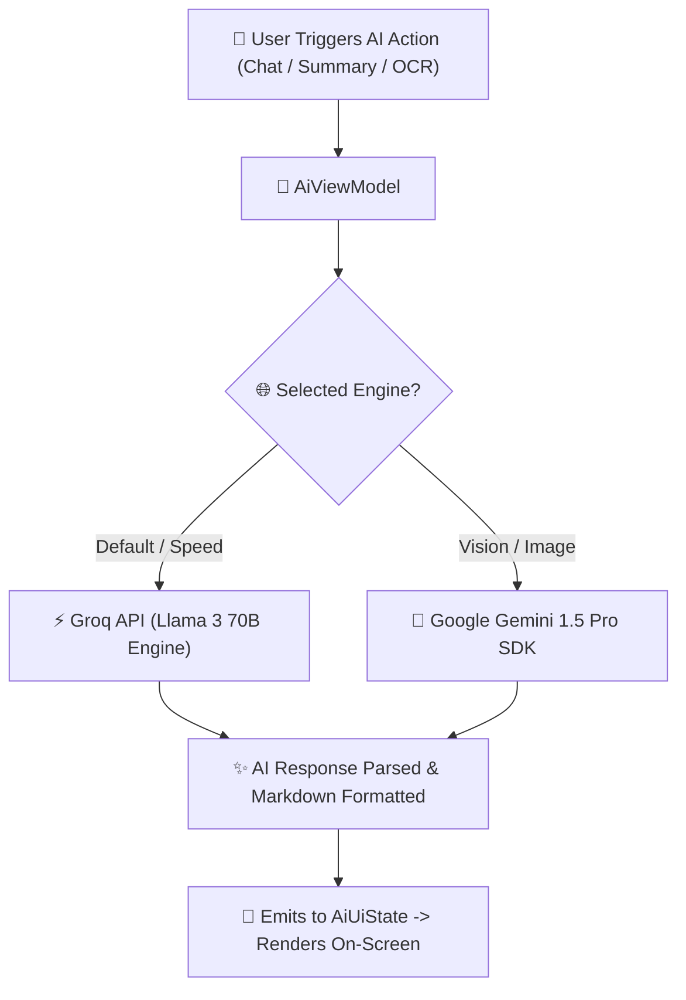
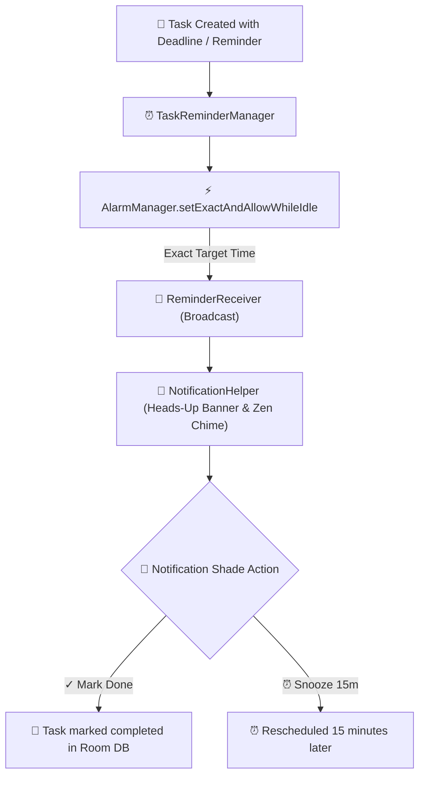

# 🚀 KNotes: Premium AI-Powered Personal Knowledge & Productivity Suite

<div align="center">

[](https://kotlinlang.org)
[](https://developer.android.com/jetpack/compose)
[]()
[]()
[](https://firebase.google.com)
[](https://www.android.com)

### ✨ Capture Thoughts • Manage Tasks • Track Habits • Unleash AI Intelligence

**KNotes** is a commercial-grade, offline-first personal knowledge management and productivity application engineered for Android. Built with pure **Kotlin**, **Jetpack Compose Material 3**, and **Clean Architecture**, KNotes seamlessly blends note-taking, task management, stylus sketching, habit analytics, and AI assistance into a single, cohesive experience.

</div>

---

## 📖 Table of Contents
- [🌳 Tree-Like Architecture & System Design](#-tree-like-architecture--system-design)
  - [🏛️ 1. Multi-Layer Clean Architecture Graph](#️-1-multi-layer-clean-architecture-graph)
  - [🔄 2. Offline-First Cloud Synchronization Flow](#-2-offline-first-cloud-synchronization-flow)
  - [🤖 3. Dual AI Engine Execution Pipeline](#-3-dual-ai-engine-execution-pipeline)
  - [🔔 4. Exact Alarm & Notification Dispatch Pipeline](#-4-exact-alarm--notification-dispatch-pipeline)
  - [📁 5. Complete Package Directory Tree](#-5-complete-package-directory-tree)
- [✨ Deep-Dive Feature Breakdown](#-deep-dive-feature-breakdown)
  - [🧘 1. AI Focus Digest & 528Hz Zen Timer](#1-ai-focus-digest--528hz-zen-timer)
  - [📊 2. Weekly Analytics & 30-Day Habit Heatmap](#2-weekly-analytics--30-day-habit-heatmap)
  - [📝 3. Rich Markdown & Stylus Sketch Pad](#3-rich-markdown--stylus-sketch-pad)
  - [🔔 4. Exact Alarms & Actionable Notifications](#4-exact-alarms--actionable-notifications)
  - [🔒 5. Production Security & Data Isolation](#5-production-security--data-isolation)
  - [📂 6. Folder Hierarchy, Version Control & Sync](#6-folder-hierarchy-version-control--sync)
- [🗄️ Database Schema & Room Migrations](#️-database-schema--room-migrations)
- [🛠️ Tech Stack & Dependencies Matrix](#️-tech-stack--dependencies-matrix)
- [🚀 Setup & Installation Guide](#-setup--installation-guide)
- [👨‍💻 Author & Contact](#-author--contact)

---

## 🌳 Tree-Like Architecture & System Design

KNotes enforces strict **Clean Architecture** combined with **MVVM (Model-View-ViewModel)**. The codebase is organized as an inverted tree hierarchy where dependencies point inward toward the core domain.

```
                                 🌳 KNOTES SYSTEM TREE
                                         │
        ┌────────────────────────────────┼────────────────────────────────┐
        ▼                                ▼                                ▼
  📱 PRESENTATION LAYER           🧠 DOMAIN LAYER                   💾 DATA LAYER
  ├── Views & Screens             ├── Domain Models                 ├── Room Storage (v12)
  │   ├── HomeCompose             │   ├── Note                      │   ├── NoteDao
  │   ├── NotesTopBar             │   ├── Task                      │   ├── TaskDao
  │   ├── TasksHeader             │   └── Folder                    │   └── FolderDao
  │   └── AnalyticsCompose        ├── UseCases                      ├── Firebase Cloud
  ├── ViewModels                  │   ├── GetNotesUseCase           │   ├── AuthRepository
  │   ├── HomeViewModel           │   ├── GetAnalyticsUseCase       │   └── SyncRepository
  │   ├── NotesViewModel          │   └── SummarizeNoteUseCase      └── Mappers
  │   └── AnalyticsViewModel      └── Repository Contracts              ├── NoteMapper
  └── UI Components                   ├── NoteRepository                └── TaskMapper
      └── FocusAlarmPlayer            └── TaskRepository
```

---

### 🏛️ 1. Multi-Layer Clean Architecture Graph


---

### 🔄 2. Offline-First Cloud Synchronization Flow


---

### 🤖 3. Dual AI Engine Execution Pipeline



---

### 🔔 4. Exact Alarm & Notification Dispatch Pipeline



---

### 📁 5. Complete Package Directory Tree

```
C:/Users/unknown/KNotes/app/src/main/java/com/example/knotes/
├── 📁 data/                        # Data Layer Implementation
│   ├── 📁 dao/                     # Room Data Access Objects (NoteDao, TaskDao, FolderDao)
│   ├── 📁 entity/                  # Database Table Entities
│   └── 📁 repository/              # Repository Implementations & Cloud Sync Logic
├── 📁 domain/                      # Domain Layer (Pure Kotlin Business Logic)
│   ├── 📁 model/                   # Pure Domain Models (Note, Task, Folder)
│   ├── 📁 repository/              # Repository Interfaces & Contracts
│   └── 📁 usecase/                 # Pure Business UseCases (Analytics, AI, Export)
├── 📁 ui/                          # Presentation Layer (Jetpack Compose & Views)
│   ├── 📁 analytics/               # 30-Day Heatmap & Habit Analytics Screen
│   ├── 📁 auth/                    # Login, Signup, Email Verification Screens
│   ├── 📁 components/              # Shared Compose Components (TopBars, Canvas, Digest)
│   ├── 📁 home/                    # Home Dashboard Screen & ViewModels
│   ├── 📁 notes/                   # Notes Library, Editor, Version History
│   ├── 📁 splash/                  # Animated Pulsing Aurora Splash Screen
│   ├── 📁 tasks/                   # Tasks Screen, Edit Task, Header Cards
│   └── 📁 theme/                   # Material 3 Color Schemes & Typography
└── 📁 util/                        # Utility & Engine Services
    ├── 📄 FocusAlarmPlayer.kt      # 528Hz Solfeggio Zen Meditation Bell Chime
    ├── 📄 TaskReminderManager.kt   # High-precision AlarmManager scheduler
    ├── 📄 NotificationHelper.kt    # Actionable notification shade dispatches
    └── 📄 SecurityManager.kt        # Biometrics & EncryptedPreferences
```

---

## ✨ Deep-Dive Feature Breakdown

### 🧘 1. AI Focus Digest & 528Hz Zen Timer
- **Productivity Velocity Gauge**: Real-time output score calculated using daily completion rate, active streak, and note creation momentum.
- **Progressive Duration Burst Launcher**: Quick duration selection (`5m`, `15m`, `25m`, `30m`, `45m`, `60m`) or fine-tuning controls.
- **Serene 528Hz Meditation Zen Bell (`FocusAlarmPlayer.kt`)**: Replaces jarring phone ringtones with a synthesized **528 Hz Solfeggio Meditation Bell Chime** (with $1056\text{ Hz}$ & $1584\text{ Hz}$ overtones, 15ms anti-click smooth attack, and exponential decay).
- **Mindful Energy Chips**: Filter workspace tasks by *⚡ High Energy*, *🧠 Deep Focus*, or *☕ Quick Wins*.

### 📊 2. Weekly Analytics & 30-Day Habit Heatmap
- **Weekly Score Ring**: Circular performance indicator with animated percentage progress (`85% Output`).
- **7-Day Interactive Bar Chart**: Mon-to-Sun task completion bars with touch tooltips and animated bar heights.
- **30-Day Activity Heatmap Grid (GitHub/Duolingo Style)**: 30 activity tiles colored across 5 density levels depending on daily task output.
- **Peak Focus Window Detection**: Identifies peak productivity hours (*🌅 Morning*, *☀️ Afternoon*, *🌆 Evening*, or *🌙 Night*).
- **Achievement Trophies**: Unlockable milestones (*🎯 First Step, 🔥 3-Day Spark, 👑 Week Warrior, ⚡ Task Crusher, 🧠 Knowledge Master*).

### 📝 3. Rich Markdown & Stylus Sketch Pad
- **Rich Editor Toolbar**: Live formatting for Bold, Italic, Highlight, Colors, Alignment, Bullet Lists, and Checklists.
- **Markdown Tables & Code Shortcuts**: 1-tap insertion of Markdown tables (`| Col 1 | Col 2 |`) and code blocks (```kotlin ... ```).
- **Stylus & Finger Sketch Pad (`SketchCanvasCompose.kt`)**:
  - Touch/Stylus gesture tracking via Compose `detectDragGestures`.
  - Tools: **🖊️ Pen**, **🖍️ Marker/Highlighter** (translucent alpha), **🧹 Eraser**.
  - **7-Color Palette & Stroke Width Slider** (Fine 3dp, Medium 7dp, Bold 14dp).
  - Exports canvas drawings to local PNG files and inserts `` inline inside notes.

### 🔔 4. Exact Alarms & Actionable Notifications
- **High-Precision Scheduling (`TaskReminderManager.kt`)**: Scheduled via Android `AlarmManager.setExactAndAllowWhileIdle` with boot recovery.
- **Actionable Notification Shade Controls**:
  - **`✓ Mark Done`**: Checks off task in Room DB directly from notification shade without launching app.
  - **`⏰ Snooze 15m`**: Reschedules the reminder 15 minutes later directly from notification shade.
- **Multi-Date Recurrence**: Repeat schedules (*Daily, Weekdays, Weekly*) with support for optional **Repeat End Dates** (`recurrenceEndDate`).

### 🔒 5. Production Security & Data Isolation
- **Authentication System**: Firebase Auth email verification, strong password policy validator (`AuthValidator.kt`), and risk-based CAPTCHA challenge generator (`CaptchaManager.kt`).
- **Complete Cache Isolation**: Logging out purges all local Room DAOs (`NoteDao`, `TaskDao`, `FolderDao`, `SearchHistoryDao`), completely isolating user data on shared devices.
- **Biometric Lock (`SecurityManager.kt`)**: Hardware biometric fingerprint/face unlock using AndroidX Biometric API.

### 📂 6. Folder Hierarchy, Version Control & Sync
- **Folder Management**: Organize notes into custom colored folders.
- **Version History (`VersionHistoryFragment.kt`)**: Auto-saves revision snapshots before major edits, allowing 1-tap version rollbacks.
- **Import/Export**: Full database backup export/import in **JSON** format.

---

## 🗄️ Database Schema & Room Migrations

KNotes runs on an offline-first **Room Database (Version 12)** with explicit migration paths:

| Migration | Key Modifications Introduced |
| :--- | :--- |
| **`MIGRATION_10_11`** | Added `recurrenceEndDate` (`INTEGER`) column to `tasks` table to support date range repeats. |
| **`MIGRATION_11_12`** | Added `lastCompletedTime` (`INTEGER`) column to `tasks` table to synchronize progress across Home and Tasks screens. |

### Core Database Entities

```
 ┌──────────────────────┐        ┌──────────────────────┐        ┌──────────────────────┐
 │        Note          │        │        Task          │        │        Folder        │
 ├──────────────────────┤        ├──────────────────────┤        ├──────────────────────┤
 │ id: Int (PK)         │        │ id: Int (PK)         │        │ id: Long (PK)        │
 │ title: String        │        │ title: String        │        │ name: String         │
 │ content: String      │        │ isCompleted: Boolean │        │ color: Int           │
 │ folderId: Long? (FK) │───────►│ deadline: Long?      │        └──────────────────────┘
 │ createdTime: Long    │        │ reminderTime: Long?  │
 │ isPinned: Boolean    │        │ recurrence: String   │
 │ isFavorite: Boolean  │        │ recurrenceEndDate    │
 └──────────────────────┘        │ lastCompletedTime    │
                                 │ relatedNoteId: Int?  │
                                 └──────────────────────┘
```

---

## 🛠️ Tech Stack & Dependencies Matrix

| Category | Technology / Library | Purpose |
| :--- | :--- | :--- |
| **Language** | Kotlin 2.0.21 | Coroutines, Flow, Sealed Interfaces |
| **UI Framework** | Jetpack Compose + Material 3 | Declarative UI, Dynamic Colors, Spring Animations |
| **Architecture** | Clean Architecture + MVVM | Scalable domain layers, separation of concerns |
| **DI Engine** | Google Hilt | Type-safe compile-time dependency injection |
| **Local Database** | Room DB v12 | Local SQLite persistence, Flow observers, Migrations |
| **Cloud Services** | Firebase Auth & Firestore | Cross-device synchronization & user management |
| **AI Intelligence** | Google Gemini SDK + Groq API | Summarization, Q&A, OCR text analysis, Auto-tagging |
| **Security** | AndroidX Biometric + Crypto | Fingerprint/Face auth & EncryptedSharedPreferences |
| **Background Tasks** | WorkManager & AlarmManager | Exact alarms, recurring reminders, boot restoration |

---

## 🚀 Setup & Installation Guide

### 1️⃣ Prerequisites
- **Android Studio**: Ladybug (2024.2.1+) or newer.
- **JDK**: Java 17 or higher.
- **Min SDK**: API 26 (Android 8.0 Oreo). Target SDK: API 35 (Android 15).

### 2️⃣ API Keys Configuration
Create or edit `local.properties` in the project root:

```properties
# Google Gemini AI API Key
AI_API_KEY=your_gemini_api_key_here

# Groq Fast LLM API Key (Optional)
GROQ_API_KEY=your_groq_api_key_here
```

### 3️⃣ Firebase Setup
1. Create a project in the [Firebase Console](https://console.firebase.google.com/).
2. Register your Android package (`com.example.knotes`).
3. Download `google-services.json` and place it in the `app/` folder.
4. Enable **Email/Password Authentication** and **Cloud Firestore**.

### 4️⃣ Build & Run
Run the Gradle assemble task via terminal:
```bash
./gradlew :app:assembleDebug
```

---

<div align="center">

### ⭐ Engineered with Precision • Built for Productivity

Crafted with ❤️ by **Akash**

</div>
